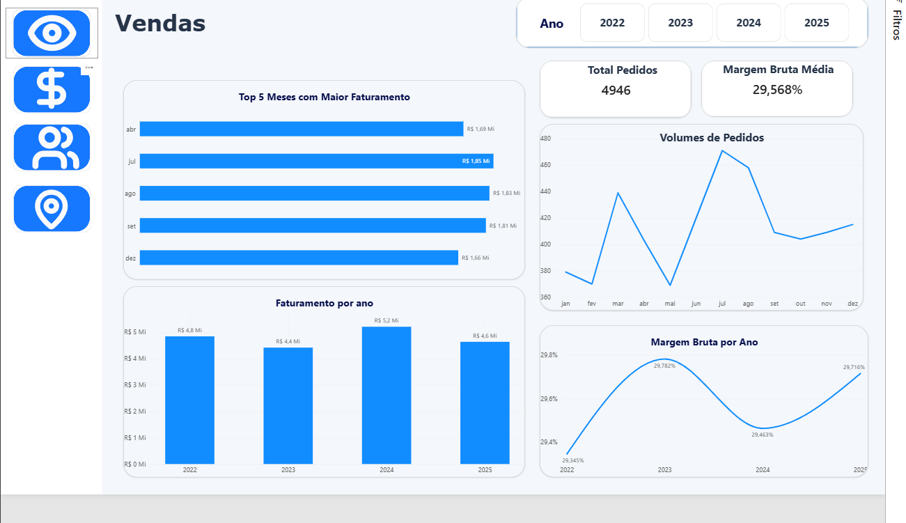
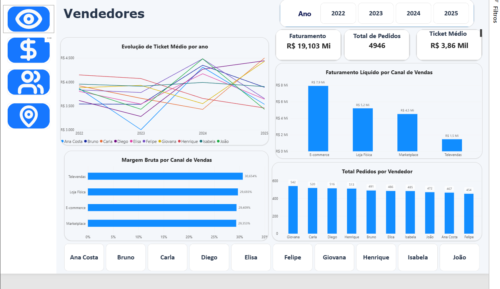

# Dashboard Projeto - Inteligência de Vendas

Projeto de Business Intelligence desenvolvido com Microsoft Power BI, com foco na análise do desempenho comercial e na transformação de dados em informações que auxiliam na tomada de decisões.

O dashboard permite acompanhar indicadores de vendas sob diferentes perspectivas, oferecendo uma visão integrada dos resultados e facilitando a identificação de tendências, oportunidades e pontos de atenção.

## Dashboards

### Visão Geral

### Vendas

### Vendedores

### Regionalização

## Tecnologias e Recursos utilizadas

- Imagens extraídas de https://lucide.dev/icons/
- One Big Table gerada com dados fictícios através do ChatGPT Go.
- SQL para extração e tratamento de dados.
- Power BI para Power Query, ETL, DAX, criação de medidas e indicadores visiveis.

## Principais Perguntas respondidas

- Qual é o faturamento e o lucro bruto da empresa?
- Como está o desempenho geral das vendas?
- Quais categorias e canais possuem maior participação nos resultados?
- Como o faturamento evoluiu ao longo dos anos?
- Quais meses apresentam maior desempenho?
- Como a margem bruta e o volume de pedidos se comportam ao longo do tempo?
- Quais vendedores possuem maior volume de pedidos?
- Como comparar o ticket médio entre vendedores?
- Existem diferenças de desempenho entre os integrantes da equipe?
- Quais regiões concentram maior faturamento e lucro bruto?
- Qual região apresenta maior ticket médio?
- Como as vendas estão distribuídas geograficamente?

## Principais insights

A análise dos dados permitiu identificar alguns padrões relevantes:

- **Evolução das vendas:** 2024 apresentou o maior faturamento entre 2022 e 2025, enquanto 2025 registrou retração em relação ao ano anterior.
- **Margem bruta:** os percentuais anuais permaneceram relativamente estáveis, próximos de 29% a 30%.
- **Categorias:** Informática apresentou o maior faturamento, seguida por Telefonia.
- **Canais de venda:** E-commerce liderou em faturamento, enquanto Marketplace e Televendas apresentaram margens brutas superiores.
- **Desempenho comercial:** foi possível identificar diferenças no volume de pedidos entre os vendedores e comparar seus resultados individualmente.
- **Distribuição regional:** o Sudeste apresentou o maior lucro bruto, enquanto o Sul registrou o maior ticket médio.

## Notas da atualização v1.01

- Inclusão de ícones da biblioteca Lucide Icons para melhorar a identificação dos elementos de navegação e facilitar a interpretação visual do dashboard.
- Ajustes na apresentação e organização dos elementos visuais.
